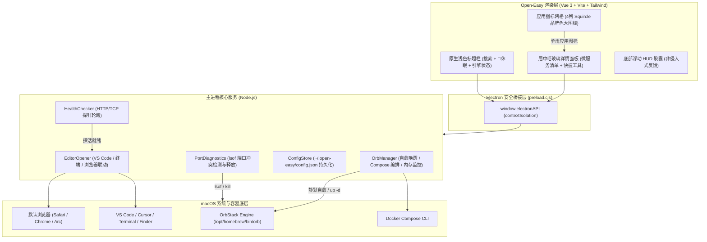

# Open-Easy (开发者工作台)

<p align="center">
  
  
  
  
  
  
  
</p>

<p align="center">
  专为 <b>macOS + OrbStack</b> 开发者打造的轻量级原生工作台应用。<br/>
  将本地复杂的 Docker Compose 微服务抽象为<b>精美的 Launchpad 应用图标</b>，提供<b>免开机静默自愈</b>与<b>一键启动直达前端网页</b>的极致体验。
</p>

---

## 📥 下载与安装 (Download)

前往 [GitHub Releases 页面](https://github.com/lyt04919/open-easy/releases/latest) 下载最新发布的安装包：

| 芯片架构 | 适用机型 | 下载文件 |
| :--- | :--- | :--- |
| **Apple Silicon** | M1 / M2 / M3 / M4 芯片 Mac | `Open-Easy-x.x.x-arm64.dmg` |
| **Intel Mac** | x86_64 传统 Intel 芯片 Mac | `Open-Easy-x.x.x-x86_64.dmg` |

### 🍏 安装步骤
1. 双击打开下载好的 `.dmg` 磁盘镜像文件；
2. 将 **Open-Easy.app** 拖动至 **Applications (应用程序)** 替身文件夹中即可完成安装。

> [!IMPORTANT]
> **首次打开提示「已损坏，无法打开」或「无法验证开发者」？**
>
> Open-Easy 是开源免费软件，未购买苹果商业开发者签名证书（$99/年），macOS Gatekeeper 安全机制会自动添加隔离标识属性。请任选以下一种方式即可正常打开：
>
> - **方法一（推荐，仅需执行一次）**：
>   打开「终端」(Terminal)，复制执行以下命令即可解除安全隔离：
>   ```bash
>   xattr -cr /Applications/Open-Easy.app
>   ```
> - **方法二**：
>   进入 macOS **「访达」 -> 「应用程序」**，找到 `Open-Easy` 图标，**按住 Control 键点按（或右键）**选择**「打开」**，在弹出的警告框中再次点击**「打开」**即可。

---

## ✨ 核心特性

- 🍏 **Apple Clean Studio 原生质感**：780×560 原生毛玻璃窗口（`#fbfbfd`），交通灯无缝内嵌，Squircle 苹果圆角高光图标；
- ⚡ **OrbStack 自动免开机感知与自愈 (Auto-Healing)**：
  - 启动项目前自动检查 Docker 引擎；
  - 若 OrbStack 处于关闭或休眠状态，**自动无感在后台静默唤醒** (`orb start` / `open -g -a OrbStack`)；
  - 引擎就绪后**无缝继续启动容器、探活端口并弹出浏览器**，全程免去人工干预；
- 🪟 **精致毛玻璃详情弹窗 (ProjectDetailModal)**：
  - 单击图标呼出居中卡片，展示微服务及容器清单（前端、后端、数据库各端口与状态）；
  - 提供大号 **「🚀 一键启动并进入前端网页」** 主按钮；
  - 快速调用 **VS Code**、**Cursor**、**系统终端** 与 **访达** 打开项目；
  - 支持自定义前端打开 URL（含路径与端口），即时生效并持久化；
- 💊 **零位移浮动 HUD 胶囊 (Zero-Layout-Shift)**：
  - 彻底淘汰推挤页面排版的顶部横幅，采用底部居中半透明浮动胶囊展示操作反馈，温和淡入淡出；
- ⚠️ **智能端口冲突诊断与释放**：
  - 启动前自动通过 `lsof` 扫描目标端口；
  - 若被本地其他进程占用，在图标标出警示微标，详情卡片中提供**一键终止冲突 PID**；
- 🌙 **一键休眠与内存释放**：
  - 一键优雅停止全部运行中的 Compose 容器，释放 OrbStack 内存与 CPU；
  - 提供一键清理未引用镜像与构建缓存功能（`docker system prune`）。

---

## 🏛️ 架构设计



---

## 🚀 快速上手

### 环境要求
- **macOS**（Apple Silicon M系列或 Intel 均可，推荐 macOS 14+）
- **Node.js** >= 18.x
- **OrbStack** 或 Docker Desktop（已安装命令行工具 `docker` 与 `orb`）

### 1. 克隆代码与安装依赖
```bash
git clone https://github.com/lyt04919/open-easy.git
cd open-easy
npm install
```

### 2. 运行单元测试
```bash
npm test
```
> 内置 Node.js 原生测试套件，全面覆盖 Compose 文件解析、端口冲突探测、HTTP/TCP 探针探活与配置持久化存储。

### 3. 开发模式启动
```bash
npm run dev
```
> 同时调起 Vite 热更新服务与 Electron 桌面客户端。

### 4. 本地打包构建与安装
```bash
# 本地快速组装 .app 并直接安装至 /Applications 目录
npm run build:app

# 制作公开发布用的 .dmg 镜像与 .zip 压缩包 (输出到 release/ 目录)
npm run package:dmg
```

---

## 📁 目录结构

```text
open-easy/
├── .github/
│   └── workflows/release.yml    # GitHub Actions 自动化多架构 DMG/ZIP 发布流水线
├── build/
│   ├── icon.icns                # 1024×1024 高清 macOS 原生应用图标
│   └── icon.png                 # 高清预览图标
├── electron/
│   ├── main.js                  # Electron 主进程入口与 IPC 通信调度
│   ├── preload.cjs              # 安全 ContextBridge 预加载桥接
│   └── services/
│       ├── orbManager.js        # OrbStack 自愈唤醒与 Compose 容器生命周期管理
│       ├── healthChecker.js     # 前端服务毫秒级轮询探针
│       ├── portDiagnostics.js   # lsof 端口冲突检测与进程释放
│       ├── databaseHelper.js    # 数据库连接探测、备份与交互终端
│       ├── editorOpener.js      # VS Code / Cursor / 终端 / 访达系统联动
│       └── store.js             # 用户配置持久化存储服务
├── src/
│   ├── components/
│   │   ├── Header.vue           # 顶部原生磨砂标题栏、快捷搜索与窗口控制
│   │   ├── BentoHeroStats.vue   # 便捷控制中心（运行统计、一键休眠、清理缓存、端口监控）
│   │   ├── BentoProjectCard.vue # 现代网格项目卡片与技术栈品牌徽标
│   │   ├── ProjectDetailModal.vue # 居中毛玻璃详情面板与微服务编排
│   │   ├── FloatingDock.vue     # 现代化全局悬浮 Dock
│   │   ├── PortManagerView.vue  # 全局端口占用与冲突诊断监控抽屉
│   │   ├── OrbStackSyncModal.vue# OrbStack 已部署容器一键快速同步抽屉
│   │   ├── SettingsModal.vue    # 原生比例应用设置偏好弹窗
│   │   └── detail/              # 详情弹窗微服务清单、日志流与终端面板
│   ├── App.vue                  # 客户端主页面与核心状态管理
│   ├── main.js                  # Vue 应用挂载入口
│   └── style.css                # Tailwind 与原生毛玻璃质感
├── scripts/
│   ├── build-mac-app.sh         # macOS 原生 Open-Easy.app 组装与本地安装脚本
│   ├── package-dmg.sh           # DMG 磁盘映像与便携 ZIP 自动化打包脚本
│   └── generate-icon.py         # 图标自动合成与多分辨率 ICNS 编译脚本
├── tests/                       # 自动化单元测试套件 (50 个单元测试通过)
├── LICENSE                      # MIT 开源协议
├── package.json                 # 依赖配置与打包脚本
└── vite.config.js               # Vite 前端构建配置
```

---

## 🗺️ 后续迭代规划 (Roadmap)

- [ ] **全局快捷键一键唤起**：支持 `⌥ + Space` 类似 Raycast / Spotlight 随时呼出工作台面板，按键盘秒级直达项目；
- [ ] **详情页内置实时控制台日志 (Live Logs)**：无需切换终端，在详情弹窗内直接流式查看前后端容器的实时彩色运行日志；
- [ ] **容器轻量资源监控**：详情页集成微型 CPU 占用率与内存波形条（Sparkline）；
- [ ] **自定义应用图标定制**：支持上传本地图片或选择自定义 Emoji 作为项目图标。

---

## 📄 开源许可

本项目遵循 [MIT](LICENSE) 开源协议。
