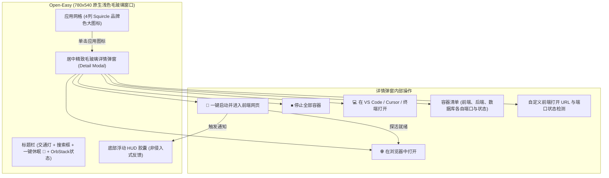

# Open-Easy (OrbStack 项目一键启动与浏览器联动工具) 设计规范

- **日期**：2026-10-13
- **项目名称**：Open-Easy
- **UI 形态**：**macOS 苹果原生浅色开发者工作台（Clean Studio Light Edition）**（780x580 独立居中原生毛玻璃窗口）
- **视觉风格**：清透温润的浅灰白基底（`#fbfbfd` / `#f0f0f3`）、经典官方技术栈品牌色 Squircle 应用图标（Vue 翡翠绿、Java 暖琥珀、Next 雅黑、Python 皇家蓝与金）、白色磨砂端口角标与 Dock 翠绿发光 LED
- **新增四大开发者核心功能**：
  1. **全局一键休眠与内存释放**：一键优雅停止全部运行中容器，休眠待机，释放 OrbStack 内存与 CPU；
  2. **智能端口冲突扫描与释放**：启动前自动检测端口是否被本地其他进程（如 Node/Java 进程）占用并报警，支持一键定位与释放；
  3. **一键打开代码编辑器与终端**：图标悬浮与右键支持一键在 VS Code / Cursor 或系统终端中打开项目目录；
  4. **OrbStack 自动免开机感知与自愈 (Auto-Healing)**：当 OrbStack 引擎处于未运行或休眠状态时，用户点击任意项目的一键启动，系统会自动静默无感拉起 OrbStack 引擎 (`open -g -a OrbStack` / `orb start`)，探活就绪后自动无缝继续拉起容器并打开浏览器，全程免去用户手动开软件的繁琐。
- **技术栈**：Electron + Vite + Vue 3 + Tailwind CSS + Node.js (Child Process & Docker CLI)

---

## 1. 目标与背景

在 macOS 平台上使用 OrbStack 进行容器化开发时，开发者通常管理着多个 Docker Compose 项目。传统的启动流程需要在终端或不同工具间反复跳转，记忆不同项目的端口号。

**Open-Easy** 采用 **macOS 启动台（Launchpad）/ 原生 App 图标网格** 的全新交互形态：
- 将每个 Docker Compose 项目抽象为一个**精美的应用图标（Squircle 苹果圆角矩形）**；
- 智能根据技术栈（Vue/React/Java/Python/Node）自动赋予专属渐变质感徽标；
- **极简一键直达**：点击未运行的应用图标，图标触发弹性缩放与加载光圈，后台自动执行 `docker compose up -d` 并轮询探活前端端口，服务就绪后**秒级自动调起默认浏览器直达前端页面**；
- **状态感知**：图标下方常驻类似 macOS Dock 的绿色运行小圆点；
- **原生管理习惯**：再次点击运行中的图标直接打开浏览器；右键图标唤起 macOS 风格 Context Menu，执行停止、重启、查看实时日志、自定义修改地址与图标等操作。

---

## 2. 界面与交互设计 (Launchpad App-Grid)

### 2.1 视觉要素与规范 (Apple Clean Studio Light Edition)
1. **App 图标（Squircle）**：
   - 尺寸：80x80px，苹果原生 `border-radius: 22.5%`；
   - 材质背景：保留各技术栈官方经典品牌配色，配合微渐变与浅色高光透亮阴影（`box-shadow: inset 0 1px 1.5px 0 rgba(255, 255, 255, 0.65), 0 10px 22px -4px rgba(0, 0, 0, 0.14), 0 3px 7px -1px rgba(0, 0, 0, 0.08)`）：
     - **Vue**: 翡翠绿与深松绿渐变 (`#42b883` ~ `#35495e`) + 白色立体 Logo
     - **Java**: 经典琥珀棕金与暖红渐变 (`#f39c12` ~ `#d35400`) + 白色立体 Logo
     - **Next.js / Node**: 极简黑曜石与深灰 (`#1f2937` ~ `#111827`) + 白色立体三角 Logo
     - **Python**: 皇家蓝配金黄双色蟒蛇 (`#3776ab` ~ `#1e415f`) + 金色徽标
   - 右上角端口角标：白色半透明毛玻璃微型 Badge（如 `:8081`、`:90`），边框温润，清晰醒目；
   - 运行中指示点：图标下方 2px 清脆浅绿色微光 LED 小圆点（Dock 风格）；
   - 启动中光晕：图标外圈播放顺滑优雅的浅绿发光波纹环（Launching Wave 动画）。
3. **通知反馈与冲突告警规范 (Zero-Layout-Shift)**：
   - **完全移除顶部通栏横幅**：避免横幅展开时挤压推移下方应用网格，保持界面始终纯净稳固；
   - **原生 HUD 悬浮胶囊 (Floating HUD Toast)**：
     - 操作反馈（如「已在 VS Code 打开」、「服务已就绪」、「已休眠容器」）采用底部居中半透明毛玻璃微胶囊（`bg-zinc-900/90 text-white rounded-full`）；
     - 悬浮于网格上方，柔和淡入，2 秒后自动淡出，不阻挡操作，不占文档流空间；
   - **卡片就地冲突弹窗 (In-place Popover)**：
     - 当项目端口被占用时，仅在对应应用图标右上角标出清脆警告微标（如 `⚠️ :90`）；
     - 点击图标或警告标，在目标图标正下方优雅弹出轻量气泡卡片，就地显示「占用 PID」与「一键释放端口」操作，解决完即自动隐去。

---

## 3. 核心模块与架构

### 3.1 项目自动发现与端口解析 (OrbManager)
1. 监听 OrbStack 守护进程与 Docker Socket 状态（支持免开机感知与自愈拉起）；
2. 自动执行 `docker compose ls --format json`，获取所有已注册项目及其 `docker-compose.yml` 路径；
3. 执行 `docker compose ps --format json` 扫描各容器名称与暴露的 Host 端口；
4. 启发式匹配技术栈与服务名，自动指派默认图标类别（Vue / React / Java / Python / Next / Docker）及前端 URL。

### 3.2 启动编排与智能探活 (HealthChecker & Auto-Healing)
1. **引擎自愈检查**：启动项目前校验 OrbStack Docker socket，若未运行则执行 `open -g -a OrbStack`（或 `orb start`），在后台静默拉起引擎，等待 socket 就绪；
2. **容器启动**：执行 `docker compose -f <path> up -d`；
3. **HTTP/TCP 探活**：500ms 间隔探活目标前端 URL（HTTP 200~399 或 TCP 连接成功）；
4. **浏览器直达**：探活成功后触发系统 `open <url>` 或 Electron `shell.openExternal(url)`；
5. **异常与超时降级**：若发生端口冲突或启动超时，通过底部 HUD 与卡片警告徽标精准定位并提供一键排查。

### 3.3 本地持久化 (ConfigStore)
- 存储用户对每个应用图标的个性化设定：
  - 自定义项目显示名称；
  - 自定义前端 URL（如附带子路径）；
  - 自定义图标样式（背景渐变色、Emoji 或自定义图片路径）。

---

## 4. 验证与端到端测试方案

1. **界面体验验证**：
   - 验证应用窗口以 740x550 优雅居中展开；
   - 验证本机 4 个项目以精美应用图标形态正确渲染；
   - 验证搜索框过滤图标顺滑无卡顿。
2. **启动与浏览器联动测试**：
   - 点击 `Hometown_vue` 图标，观察按压弹性动画与启动光晕；
   - 观察主进程调用 `docker compose up -d`；
   - 探活端口 8081 成功后，验证系统浏览器自动弹出并载入页面；
   - 验证图标下方亮起绿色运行圆点；
   - 再次点击该图标，验证直接拉起网页。
3. **右键管理测试**：
   - 右键点击运行中的项目，选择「停止容器」，验证容器停止且绿色圆点熄灭。
