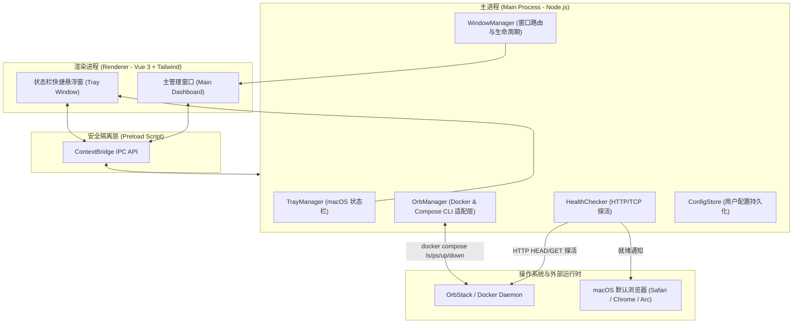

# Open-Easy (OrbStack 项目一键启动与浏览器联动工具) 设计规范

- **日期**：2026-10-13
- **项目名称**：Open-Easy
- **技术栈**：Electron + Vite + Vue 3 + Tailwind CSS + Node.js (Child Process & Docker CLI)

---

## 1. 目标与背景

在 macOS 平台上使用 OrbStack 进行容器化开发时，开发者通常管理着多个由 Docker Compose 编排的项目（如个人博客、JavaWeb 前后端分离系统、各类学习 demo）。
传统的启动流程繁琐：
1. 打开终端或 OrbStack 客户端定位项目；
2. 执行 `docker compose up -d` 启动多个前后端容器；
3. 等待容器初始化、等待 Spring Boot / Node 等服务完全就绪；
4. 手动在浏览器输入对应的 `localhost:<port>` 端口打开页面。

**Open-Easy** 旨在提供极简的 macOS 桌面与状态栏原生体验：
- **自动发现** 本机 OrbStack/Docker Compose 项目；
- **智能解析** 前端对外暴露端口与访问地址；
- **一键启动**：后台执行容器启动，并在服务真正响应时通过**健康轮询探活**，**自动拉起系统浏览器**进入前端页面；
- **状态常驻**：支持 macOS 顶部菜单栏快捷面板与完整管理窗口双模式。

---

## 2. 系统架构

---

## 3. 核心模块与功能设计

### 3.1 项目自动发现与端口解析 (OrbManager)
1. **自动感知已有项目**：
   - 周期性调用 `docker compose ls --format json`，获取所有已注册的 Compose 项目及其对应的 `config_files` (docker-compose.yml 绝对路径)。
   - 对每个项目调用 `docker compose -f <path> ps --format json`，获取各个服务的容器名、运行状态（running, exited）及对外暴露的 Host 端口。
2. **前端服务与端口启发式推导算法**：
   - 扫描 services，优先匹配名称包含 `frontend`、`web`、`client`、`ui`、`blog`、`app` 的服务。
   - 提取对外发布的 Host 端口（如 80, 8081, 2025, 90, 3000, 5173 等）。
   - 默认推导 URL 为：`http://localhost:<HostPort>`。
   - 如果用户在界面自定义过该项目的 URL，则优先读取持久化配置中的自定义 URL。

### 3.2 启动编排与智能就绪探活 (HealthChecker)
1. **启动指令**：
   - 调用 `docker compose -f <path> up -d` 异步启动容器。
   - 检测 OrbStack 是否在运行，若未运行则提示或唤醒 `open -a OrbStack`。
2. **就绪检测**：
   - 容器启动命令返回后，进入探活循环：每 500ms 向目标前端 URL 发起 HTTP GET/HEAD 请求（或对纯静态/TCP 端口进行 socket 连接尝试）。
   - 超时阈值设为 30 秒。
   - 一旦收到有效 HTTP 响应状态码（200 ~ 399）或 TCP 握手成功：
     - 调用 Electron `shell.openExternal(targetUrl)` 打开系统默认浏览器；
     - 向前端渲染进程发送 `project-ready` 事件，将卡片状态更新为「运行中」。
   - 若超时仍未响应：
     - 卡片提示「容器已启动，探活未就绪」，提供手动打开与查看日志选项。

### 3.3 本地配置持久化 (ConfigStore)
- 存储路径：`~/Library/Application Support/open-easy/config.json`
- 结构字段：
  - `projects`: 自定义别名、指定前端 URL、置顶标记、自定义启动命令（如有特殊环境变量需求）。
  - `settings`: 是否开机自启、默认使用 localhost 还是 orb.local 域名、探活超时时间。

### 3.4 交互设计 (UI & Tray)
1. **顶部状态栏图标 (Tray)**：
   - 状态栏图标：常驻 macOS 菜单栏。
   - 点击图标：在菜单栏下方弹出紧凑轻量面板（支持快捷搜索、最近使用的项目一键启动并进入）。
2. **完整控制面板 (Window)**：
   - 详尽展示每个项目的多容器运行状态（后端、前端、数据库各自独立状态）。
   - 提供「导入本地目录」原生文件选择器。
   - 容器实时日志抽屉（实时执行 `docker compose logs -f --tail=100`）。

---

## 4. IPC 通信接口规范

| 通道名称 | 参数 | 返回值 / 事件 | 说明 |
|---|---|---|---|
| `orb:check-status` | 无 | `{ running: boolean }` | 检查 OrbStack 是否正常运行 |
| `projects:list` | 无 | `ProjectItem[]` | 获取所有本地 Compose 项目及状态 |
| `projects:launch` | `{ id: string, openBrowser: boolean }` | `{ success: boolean, message?: string }` | 启动项目并探活进入前端 |
| `projects:stop` | `{ id: string }` | `{ success: boolean }` | 停止 Compose 项目 |
| `projects:open-browser` | `{ url: string }` | `void` | 调用系统浏览器打开指定 URL |
| `projects:save-config` | `{ id: string, config: ProjectConfig }` | `{ success: boolean }` | 保存项目自定义 URL 或别名 |
| `projects:import-dir` | 无 (主进程打开原生弹窗) | `ProjectItem \| null` | 选取本地目录并导入 compose 文件 |

---

## 5. 边界与异常处理

1. **OrbStack 守护进程未启动**：
   - 探测到 Docker Socket 不可用时，界面醒目提示「OrbStack 未运行」，并提供「一键唤醒」按钮（调用 macOS 原生 `open -a OrbStack`）。
2. **容器端口冲突**：
   - 捕获 `docker compose up` 错误输出（如 `bind: address already in use`），自动弹出日志排查窗口并标记具体冲突端口。
3. **前端编译/冷启动缓慢**：
   - 探活提供明确的加载状态反馈（「启动中，正在等待端口 8081 就绪...」），避免用户因误以为卡死而重复点击。

---

## 6. 验证与测试方案

1. **单元与集成测试**：
   - 验证 Compose 项目自动发现能力（解析当前电脑已有的 `hometown_vue`, `2025-blog-public`, `web-ai-project02`）。
   - 验证端口推导与启发式规则准确率。
   - 验证 HealthChecker 轮询与超时机制。
2. **真实场景端到端验证**：
   - 点击 `Hometown_vue` 的「🚀 启动并进入」；
   - 观察容器从 Exited 变为 Running；
   - 观察探活就绪后，系统 Safari/Chrome 是否准时弹出并成功加载前端页面；
   - 点击停止，观察容器优雅关闭。
